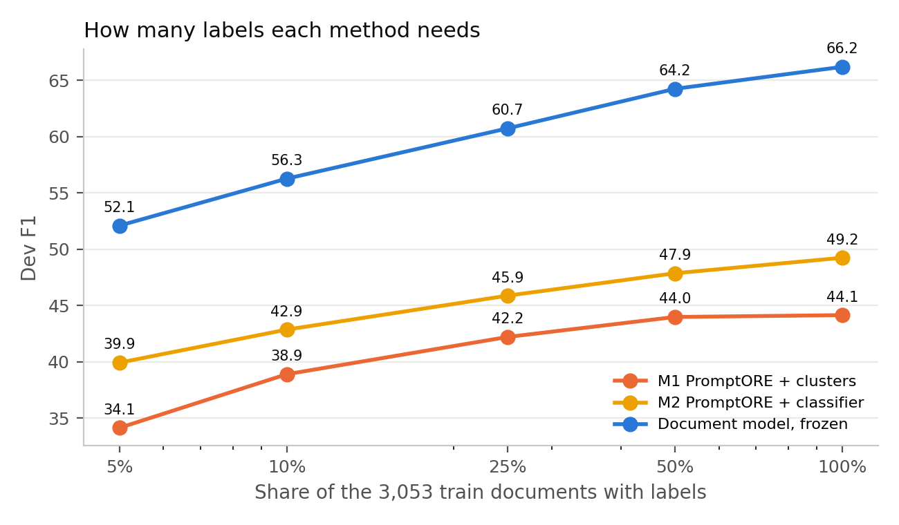

# Experiment B: labels needed

Dev F1 when the methods are trained on a random share of the 3,053 train documents. Each share is drawn twice (seeds 0 and 1); the same seed draws the same documents for every method (`linked_docred.train_subset`). The fact threshold, and k for M1, are chosen on dev, as for the full runs. Test is not used.

- M1 and M2: `scripts/label_efficiency.py`, on the cached PromptORE train sample (all related pairs and 3 unrelated pairs per related one). k = 400 was the best of 50, 100, 200 and 400 at every share.
- Document model: `scripts/train_doc_model.py --train-fraction`, settings of `doc-full` (frozen bert-base-cased, pair features, 2 token layers, 2 pair layers, learning rate 1e-4), 40 / 30 / 25 / 20 epochs for 5 / 10 / 25 / 50%. The 100% row is `doc-full`, mean of 3 seeds.

| Train documents | M1 PromptORE + clusters | M2 PromptORE + classifier | Document model, frozen |
|---|---|---|---|
| 5% (153) | 34.15 (34.48, 33.82) | 39.94 (40.13, 39.74) | 52.10 (52.32, 51.87) |
| 10% (305) | 38.91 (38.60, 39.21) | 42.87 (42.86, 42.87) | 56.26 (56.22, 56.30) |
| 25% (763) | 42.22 (41.86, 42.57) | 45.88 (45.64, 46.12) | 60.73 (60.61, 60.84) |
| 50% (1,526) | 43.99 (43.90, 44.07) | 47.87 (47.73, 48.00) | 64.23 (63.99, 64.47) |
| 100% (3,053) | 44.15 | 49.24 | 66.18 ± 0.3 |

## What it shows

- **The supervised document model needs fewer labels than PromptORE.** Trained on 153 documents (5%), it already beats both PromptORE methods trained on all 3,053 documents (52.1 against 49.2 and 44.2).
- **Every method keeps most of its score with few labels.** With 5% of the documents, M1, M2 and the document model keep 77%, 81% and 79% of their full dev F1.
- **M1 saturates first:** it gains only 0.2 points from 50% to 100%. Its clusters do not use the labels; they are only used to name the clusters and train the detector. M2 and the document model still gain 1.4 and 2.0 points.
- **The two draws of each share differ by less than 0.7 point,** so the curves are well above draw noise.
- **Why PromptORE does not win in the low-label regime, as its design suggests:** the labels it uses are mostly for detection (is the pair related?), and detection is the hard part on this data (93% to 94% of the pairs have no relation). The `[MASK]` embedding of one prompt with the mention sentences is a weaker detection signal than a model that reads the whole document.
